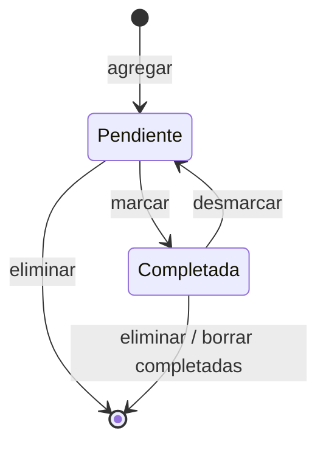

# Entidades y reglas

> Estado: 🟢 Estable | Última actualización: 2026-11-23
> Autor: Kevin-Stiven-Lopez-Amaya404 | Equipo: lista-tareas
## Tarea

| Atributo | Tipo | Regla |
|----------|------|-------|
| `id` | texto (UUID) | Se genera al crear con `crypto.randomUUID()`; no cambia |
| `texto` | texto | Sin espacios al inicio ni al final; nunca vacío |
| `completada` | booleano | `false` al crear |

## Reglas de negocio

| ID | Regla | Dónde se cumple |
|----|-------|-----------------|
| RN-01 | Una tarea no puede tener texto vacío ni solo espacios, ni al crear ni al editar | `agregarTarea`, `editarTarea` (`src/tareas.js`) y el botón deshabilitado ([ADR-003](../05-architecture/decisions/records/ADR-003-agregar-deshabilitado-campo-vacio.md)) |
| RN-02 | Las tareas se muestran en el orden en que se agregaron | Todas las funciones devuelven una lista nueva conservando el orden |
| RN-03 | Eliminar y borrar completadas no piden confirmación | [ADR-004](../05-architecture/decisions/records/ADR-004-eliminar-sin-confirmacion.md) |
| RN-04 | El resumen cuenta todas las tareas, sin importar el filtro | `resumen(tareas)` |
| RN-05 | Un filtro desconocido muestra todas las tareas | `filtrarTareas` |
| RN-06 | Solo una tarea puede estar en edición a la vez | `src/main.js` |
| RN-07 | Lo guardado se trata como no confiable: lo inválido se descarta | `cargarTareas` ([ADR-005](../05-architecture/decisions/records/ADR-005-persistencia-localstorage.md)) |
