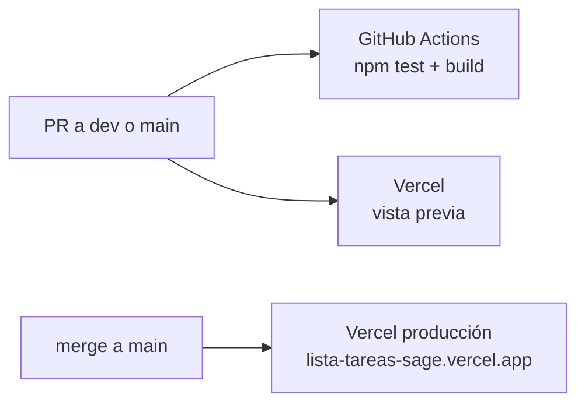

# Despliegue

> Estado: 🟢 Estable | Última actualización: 2026-11-23
> Autor: Kevin-Stiven-Lopez-Amaya404 | Equipo: lista-tareas
Detalle en [ADR-008](./decisions/records/ADR-008-despliegue-vercel.md) y [10-devops/environments.md](../10-devops/environments.md).

- **Proveedor:** Vercel, proyecto `lista-tareas`, conectado al repositorio de GitHub.
- **Producción:** rama `main` → https://lista-tareas-sage.vercel.app/
- **Build:** `npm run build` → `dist/`.
- **`vercel.json`:** cabeceras de seguridad (CSP solo con Google Fonts como origen externo, HSTS, `X-Frame-Options: DENY`, `nosniff`, `Referrer-Policy`, `Permissions-Policy`) y caché inmutable para `/assets/` (nombres con hash).
