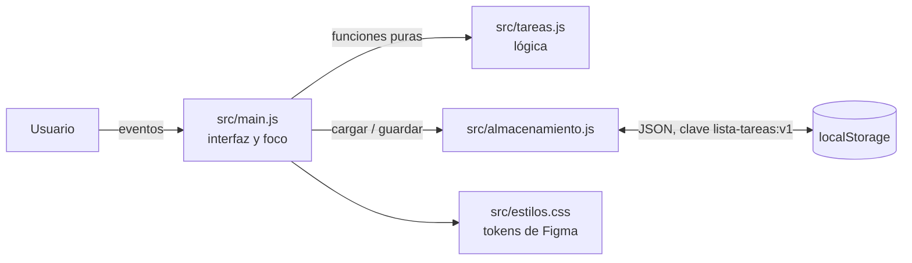

# Vista de arquitectura

> Estado: 🟢 Estable | Última actualización: 2026-11-23
> Autor: Kevin-Stiven-Lopez-Amaya404 | Equipo: lista-tareas
App web estática, sin framework y sin servidor propio ([ADR-001](./decisions/records/ADR-001-stack-vite-javascript-vitest.md)).

| Módulo | Responsabilidad | Pruebas |
|--------|-----------------|---------|
| `src/tareas.js` | Lógica pura: agregar, completar, editar, eliminar, borrar completadas, filtrar, resumen. Nunca toca el DOM y siempre devuelve una lista nueva | `src/tareas.test.js` |
| `src/almacenamiento.js` | Cargar y guardar en `localStorage`, validando lo guardado | `src/almacenamiento.test.js` |
| `src/main.js` | Dibuja la lista, maneja eventos, edición, filtros y foco | Verificación en navegador |
| `src/estilos.css` | Estilos con los tokens de Figma como variables CSS | — |

**Flujo:** cada acción del usuario llama a una función de `tareas.js`, se guarda el resultado con `guardarTareas` y se vuelve a dibujar la lista.
