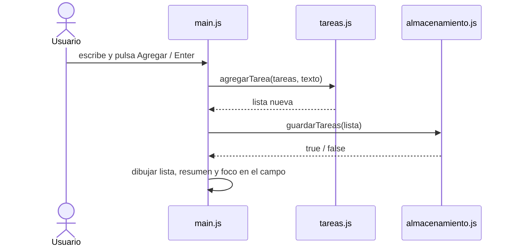

# Diagramas

> Estado: 🟢 Estable | Última actualización: 2026-11-23
> Autor: Kevin-Stiven-Lopez-Amaya404 | Equipo: lista-tareas
Los diagramas se escriben en **Mermaid** dentro del Markdown: GitHub los dibuja y la fuente es el propio texto, así que no hacen falta exportaciones.

| Diagrama | Tipo | Dónde |
|----------|------|-------|
| Módulos y flujo de datos | Flujo | [05-architecture/overview.md](../05-architecture/overview.md) |
| Despliegue | Flujo | [05-architecture/deployment.md](../05-architecture/deployment.md) |
| Ciclo de vida de una tarea | Estados | [02-domain/entities-and-rules.md](../02-domain/entities-and-rules.md) |
| Agregar una tarea | Secuencia | Abajo |

## Secuencia: agregar una tarea

